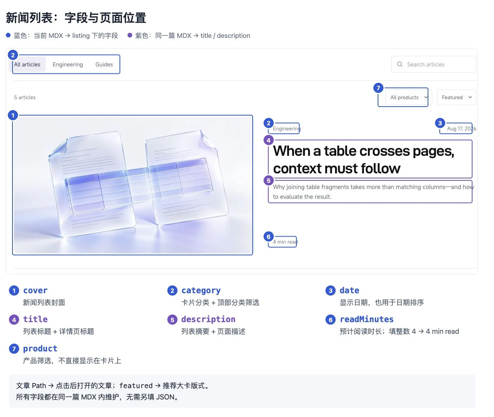
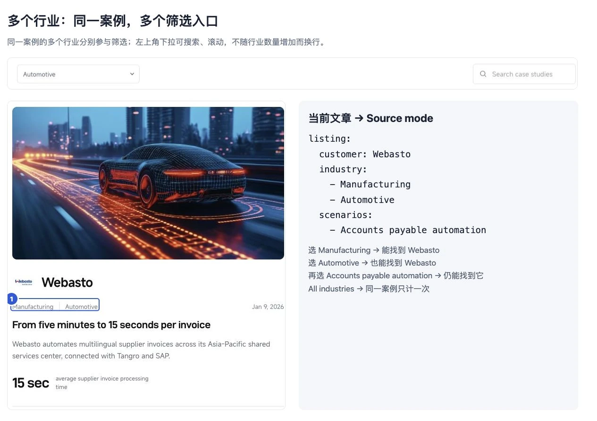

# TextIn Resources · 运营操作指南

控制台 **Files → README.md** 可查看本指南。每篇文章只维护一个 MDX：页头决定列表展示，下面编写正文。无需另外填写 JSON，也无需修改列表文件。

## 1. 打开要修改的文章

| 要做什么 | 打开哪里 | 修改位置 |
| --- | --- | --- |
| 修改案例 | Navigation → Customer stories → 对应客户 | 正文直接编辑；列表信息打开 `… → Source mode` |
| 修改新闻 | Navigation → Journal → 对应文章 | 同上 |
| 修改标题、摘要 | 文章顶部，或 `… → Page settings` | `title`、`description` |
| 修改封面、日期、分类、客户信息 | 当前文章 → `… → Source mode` | 页头的 `listing` 区域 |
| 上传图片 | Files → `images/` | 上传后将路径填入当前文章 |
| 修改布局、按钮、公共 CTA | 交给开发 | 无需运营调整 |

文章路径就是文件位置，例如 `cases/acme-contract-review.mdx` 对应 `/cases/acme-contract-review`。已上线文章保留原路径。

## 2. 新增一篇内容

1. 打开右上角 **… → Branches**，新建内容分支，例如 `content/new-customer`。
2. 点击 **New page**；在 **… → Page settings → Path** 填写 `cases/英文短名称` 或 `news/英文短名称`。
3. 打开 **… → Source mode**，参考下面模板填写页头和正文。
4. 上传封面，有已确认的客户 Logo 时一并上传，将路径填入 `listing`。
5. 保存到工作分支，等待自动生成，再检查完整站点预览。通过后审核发布。

### 案例模板

```mdx
---
title: "How Acme makes contract review traceable"
description: "How Acme connects extracted clauses to their source documents."
keywords:
  - contract analysis
  - xParse
listing:
  customer: Acme
  industry:
    - Automotive
    - Manufacturing
  scenarios:
    - Contract analysis
  product: xParse
  date: "2026-10-26"
  cover: /images/cases/acme/cover.webp
  customerLogo: /images/cases/acme/logo.webp
  metric:
    value: "60%"
    label: "less time spent on manual review"
  order: 0
  featured: false
---

Introduce the customer and the business context.

## The challenge

Describe the problem and its business impact.

## The solution

Explain the workflow and the role of TextIn.

## The results

Describe verified outcomes and supporting evidence.
```

Acme、图片路径和成果均为示例，发布前替换为已确认的信息；没有 Logo 时删除 `customerLogo` 一行。

### 新闻页头模板

替换为文章自己的标题、摘要和图片，在第二条 `---` 之后编写正文。

```yaml
---
title: "Your article title"
description: "A short summary of the article."
keywords:
  - document intelligence
listing:
  category: Guides
  product: xParse
  date: "2026-10-26"
  cover: /images/journal/your-cover.webp
  readMinutes: 4
  order: 0
  featured: false
---
```

`listing` 下缩进两个空格；`metric.value` 等下一层再缩进两个空格。不使用 Tab。日期和带 `%` 等符号的成果值用引号包住。

## 3. 对照页面找字段

图中蓝框对应**当前文章 `listing` 下的字段**，紫框对应**同一篇文章的 `title`、`description`**。点击图片可放大。

### 案例列表

[](images/guide/cases-fields.webp)

例如：只改客户名称，修改 `listing.customer`；只改卡片标题，修改页头的 `title`。两者都在当前 MDX 内。

### 新闻列表

[](images/guide/news-fields.webp)

例如：将 `listing.readMinutes` 从 `4` 改为 `6`，卡片显示 `6 min read`；修改 `listing.category`，卡片分类与上方筛选同步变化。

### 一篇案例设置多个行业

[](images/guide/multi-industry.webp)

`listing.industry` 支持单个名称或数组。行业与场景分开维护：行业填 `industry`，应用场景填 `scenarios`。多个行业各自参与筛选，同一案例不会重复计数。

## 4. 常用配置与结果

下表字段均位于 `listing` 内，标题、摘要和关键词除外。

| 修改项 | 结果或规则 |
| --- | --- |
| `order` | 默认顺序，数字越小越靠前；省略为 `0`。相同值按日期从新到旧，再按文章路径排序 |
| `featured: true` | 使用推荐大卡版式；案例、新闻各最多一篇。不会自动置顶，需要同时调整 `order` |
| `date` | 展示日期，参与 Newest first / Oldest first 排序；未来日期不会定时发布 |
| `industry` / `category` | 案例行业可填多个；新闻分类填单个名称。新名称自动成为筛选项，沿用现有英文名称及大小写 |
| `scenarios` | 案例场景数组，一个场景写一项，不将多个名称拼成一个字符串 |
| `product` | 新闻填单个产品；案例支持单个产品或 `[xParse, DocFlow]` |
| `cover` / `customerLogo` | 封面与列表客户 Logo，路径以 `/images/` 开头；不会替换正文图片 |
| `metric.value` / `metric.label` | 成果值与说明，两个都必填，须有事实支撑 |
| `readMinutes` | 新闻预计阅读分钟数，填大于 `0` 的整数 |
| `keywords` | 页头的关键词，用于 SEO，不会新增列表筛选项 |
| 删除整个 `listing` 区域 | 从列表和文章导航撤下，正文文件与原网址仍保留 |

两组列表每页 5 条；搜索、分类、场景、产品和排序覆盖全部文章。首页 Journal 展示日期最新的 3 篇新闻，不受 `order`、`featured` 影响。

## 5. 编写正文与图片

| 操作 | 呈现结果 | 用法 |
| --- | --- | --- |
| 输入 `/`，选择 Heading 2 / Heading 3 | 章节、小标题与目录 | 正文从二级标题开始，不重复文章标题 |
| 插入图片或拖入图片 | 当前位置显示图片 | 正文图片单独维护，填写简短英文说明 |
| 插入 List、Table | 要点、对比表格 | 长段落使用普通正文 |
| 官方 Note、Tip、Warning | 提示框 | 只保留影响读者操作的信息 |
| 官方 Steps、Accordion、Tabs | 步骤、折叠区、切换内容 | 用于连续步骤或并列内容 |
| 普通链接 | 可点击文字 | 站内使用 `/cases/文章路径` 或 `/news/文章路径` |

图片优先上传 WebP。封面建议横向、重点居中，列表会裁切边缘；封面和 Logo 支持 `.webp`、`.jpg`、`.jpeg`、`.svg`。

正文只使用 Markdown 和 Mintlify 官方组件，不添加 `<time>`、`<div>`、自定义组件或脚本。文章信息栏、返回列表和底部 CTA 自动生成，不编辑 `content:metadata`、`content:footer` 注释之间的内容。

## 6. 保存、预览与发布

| 操作 | 会发生什么 |
| --- | --- |
| 在控制台编辑正文 | 编辑器显示正文效果；草稿尚未发布 |
| 修改当前文章页头的 `listing` | 配置保存在当前文章；完整列表等待自动生成 |
| Publish 菜单 → Save in branch，或提交到内容分支 | GitHub Actions 的 Content publishing 校验 MDX，自动更新列表、文章导航和分页 |
| 自动生成提交完成后打开最新分支预览 | 可以检查列表信息、筛选、详情、返回状态和底部联系按钮 |
| 审核通过后 Merge and publish，或由负责人合并 | 正式站点构建成功后显示更新 |

控制台自动保存草稿不会直接重建完整列表。**列表跟随提交到 Git 的 MDX 自动更新**；无需修改 JSON 或生成文件。Mintlify 构建与 Actions 分别运行，检查最新生成提交对应的预览。

## 7. 常见问题

| 情况 | 处理 |
| --- | --- |
| 新文章未出现在列表 | 检查当前 MDX 是否有完整 `listing`，以及自动生成和最新预览是否成功 |
| 保存后列表没变 | 确认已提交工作分支，等待 Content publishing 和最新预览构建完成 |
| 想取消推荐大卡 | 将 `listing.featured` 改为 `false` |
| 想彻底下线文章 | 删除 MDX 并清理相关链接；旧网址重定向交给开发 |
| 页头校验失败 | Actions → Content publishing → validate，按报错中的 MDX 路径与字段修正 |
| 提示 `could not be rendered` | 切 Source mode 检查非官方标签；自动生成区域的问题交给开发 |
| 自动生成写回失败或出现合并冲突 | 交给开发检查，不直接覆盖其他人的内容 |

不要编辑 `index.mdx`、`cases/list.mdx`、`news/list.mdx` 及分页文件，自动生成会覆盖它们。本指南保存在公开仓库，不写入账号、密钥或未公开资料。

## 8. 开发维护

使用 Node.js 24 LTS：

```sh
npm ci --ignore-scripts
npm run preview
```

本地预览：[localhost:3001](http://localhost:3001)。预览命令监听文章、图片和模板；保存 MDX 后自动校验、生成并刷新页面。校验失败保留上次生成的列表，修正并保存后自动恢复。

已有预览服务时，可单独运行 `npm run content:watch` 启动生成监听；一次性生成使用 `npm run content:build`。

`content/site.json` 仅保存站点域名，`content/schema.json` 仅定义校验规则，均由开发维护，不存放文章信息。页面路径从 MDX 文件名自动读取；所有文章的列表配置与正文都在自身文件内。

```sh
npm test
npm run content:check
node --check cases.js
npx --yes mint@4.2.1096 validate
npx --yes mint@4.2.1096 broken-links
```

首次接入须同步到控制台连接的仓库，确认 Actions 启用、机器人可写回内容分支，并验证“新增 MDX → 自动生成 → 分支预览 → 合并发布”。本地验证不等于控制台流程或正式发布已完成。
