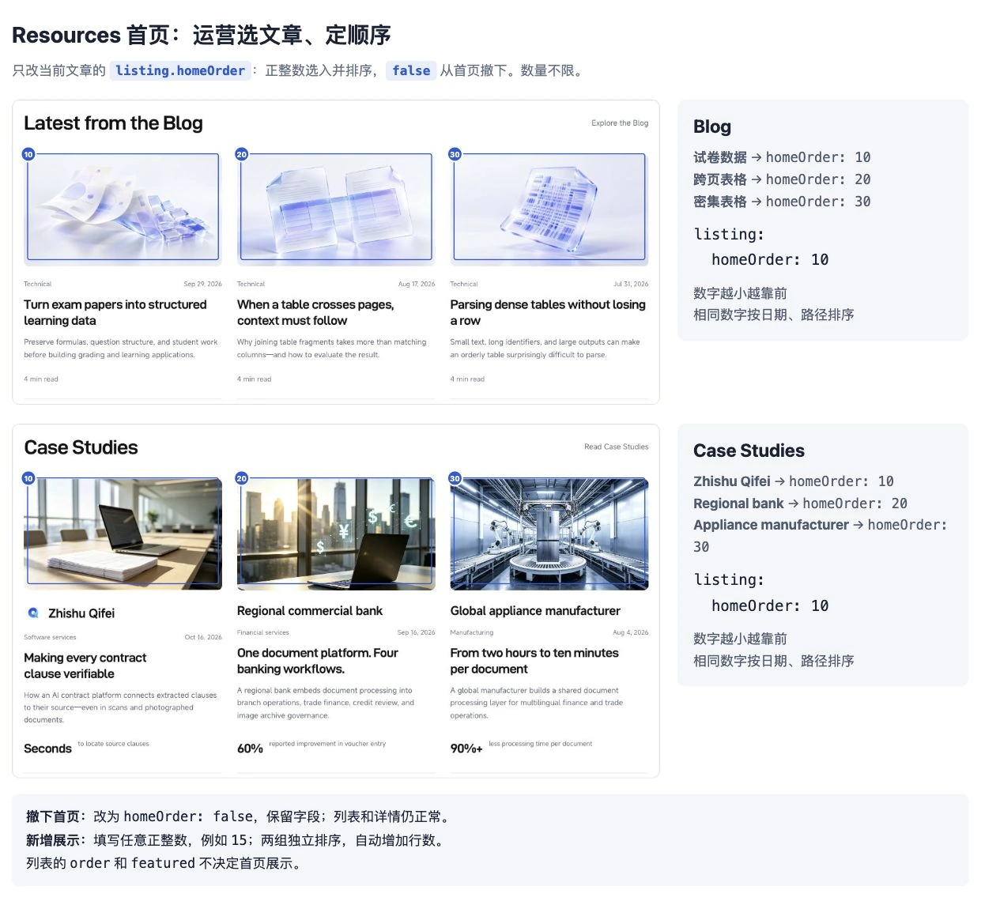

# TextIn Resources · 运营操作指南

控制台 **Files → README.md** 可查看本指南。每篇文章只维护一个 MDX：页头配置首页和列表展示，下面编写正文。

## 1. 打开文章

| 要做什么 | 打开哪里 | 修改位置 |
| --- | --- | --- |
| 修改 Blog | Navigation → Blog → 对应文章 | 正文直接编辑；配置打开 `… → Source mode` |
| 修改案例 | Navigation → Case Studies → 对应客户 | 同上 |
| 修改标题、摘要 | 文章顶部或 `… → Page settings` | `title`、`description`，同步首页、列表和详情 |
| 选入首页、撤下、排序 | 当前文章 → Source mode | `listing.homeOrder` |
| 修改封面、日期、分类、客户与 Point | 当前文章 → Source mode | `listing` 区域 |
| 上传图片 | Files → `images/` | 上传后将路径填入当前文章 |

文章路径就是文件位置，例如 `cases/acme-contract-review.mdx` 对应 `/cases/acme-contract-review`。已上线文章保留原路径。

## 2. 决定 Resources 首页展示什么

[](images/guide/home-selection.webp)

在文章页头的 `listing` 内修改：

```yaml
listing:
  homeOrder: false
```

| 配置 | 首页结果 |
| --- | --- |
| `homeOrder: false` | 从首页撤下，保留字段；列表和详情仍正常展示 |
| `homeOrder: 10` | 选入首页，数字越小越靠前 |
| `10`、`20`、`30` | 按顺序展示；插入一篇时可填 `15` |
| 多篇填写相同数字 | 按日期从新到旧，再按文章路径排序 |
| 同一类全部设为 `false` | 首页隐藏该文章区块；入口卡片与列表仍保留 |

Blog 自动进入 **Latest from the Blog**，案例进入 **Case Studies**，两组独立排序。数量不限，页面自动增加行数。没有选中的文章不会自动补入。

填写 `false` 时不加引号；展示时填大于 `0` 的整数，不填 `true`、`0` 或带引号的数字。新文章模板默认带上 `homeOrder: false`；遗漏时自动补回 `false`。

首页排序与列表的 `order`、`featured` 分开。只调整首页时，不修改这两个字段。首页 Hero、入口说明和公共 CTA 由开发维护。

## 3. 新增文章

1. 右上角 **… → Branches**，新建内容分支，例如 `content/new-customer`。
2. 点击 **New page**；在 **… → Page settings → Path** 填写 `cases/英文短名称` 或 `news/英文短名称`。
3. 打开 **… → Source mode**，参考下面模板填写页头和正文。
4. 上传封面，有已确认的客户 Logo 时一并上传，填写图片路径。
5. 提交工作分支，等待自动生成后检查预览，再审核发布。

### Case Studies 模板

```mdx
---
title: "How Acme makes contract review traceable"
description: "How Acme connects extracted clauses to their source documents."
keywords:
  - contract analysis
  - xParse
listing:
  homeOrder: false
  customer: Acme
  industry:
    - Automotive
    - Manufacturing
  scenarios:
    - Key information extraction
  product: xParse
  date: "2026-10-27"
  cover: /images/cases/acme/cover.webp
  customerLogo: /images/cases/acme/logo.webp
  metric:
    value: "60%"
    label: "less time spent on manual review"
  order: 0
  featured: false
---

Introduce the customer and the business context.

## The challenge

Describe the problem and its business impact.

## The solution

Explain the workflow and the role of TextIn.

## The results

Describe verified outcomes and supporting evidence.
```

客户、图片路径和成果均为示例，发布前替换为已确认的信息；没有 Logo 时删除 `customerLogo` 一行。

### Blog 页头模板

在第二条 `---` 后编写正文。

```yaml
---
title: "Your article title"
description: "A short summary of the article."
keywords:
  - document intelligence
listing:
  homeOrder: false
  category: Technical
  product: xParse
  date: "2026-10-27"
  cover: /images/journal/your-cover.webp
  readMinutes: 4
  order: 0
  featured: false
---
```

`listing` 下缩进两个空格，下一层再缩进两个空格；不使用 Tab。日期和带 `%` 等符号的成果值用引号包住。

## 4. 对照列表找字段

蓝框对应当前文章 `listing` 下的字段，紫框对应同一篇文章的 `title`、`description`。点击图片可放大。

### Case Studies

[](images/guide/cases-fields.webp)

客户名称修改 `listing.customer`；卡片与详情标题修改 `title`；重点 Point 修改 `listing.metric.value` 和 `listing.metric.label`，支持文字，不限于数字。

### Blog

[](images/guide/news-fields.webp)

`listing.readMinutes: 6` 显示 `6 min read`。`category` 只选 `Announcements` 或 `Technical`：前者用于公告、产品更新，后者用于技术解析、实践指南。分类暂无文章时显示空状态。

### 多行业案例

[](images/guide/multi-industry.webp)

`industry` 支持单个名称或数组；`scenarios` 使用数组。多个行业分别参与筛选，同一案例不重复计数。

列表左上角的行业下拉支持搜索和滚动，选项从全部文章汇总，不随数量增加而换行。输入 `auto` 可找到 `Automotive`；点击后更新案例，选择 `All industries` 清除行业条件。菜单搜索只查行业名称，右侧搜索框查案例内容；行业可与场景、产品组合筛选。

## 5. 行业与场景名称

按国内版对应关系选择下面的英文名称，保留大小写，不自行拼接或改写标签。

| 国内行业 | `industry` |
| --- | --- |
| 国央企 | State-owned enterprises |
| 金融 | Financial services |
| 物流 | Logistics |
| 医疗医药 | Healthcare & pharmaceuticals |
| 教育 | Education |
| 制造业 | Manufacturing |
| 交通运输 | Transportation |
| 汽车 | Automotive |
| 软件服务 | Software services |

| 国内场景 | `scenarios` 中的一项 |
| --- | --- |
| 文档信息结构化 | Document structuring |
| 关键信息抽取 | Key information extraction |
| 多语言 OCR | Multilingual OCR |
| 企业知识库与 RAG | Enterprise knowledge bases & RAG |
| 企业 AI 中台建设 | Enterprise AI platforms |
| 教育题库数字化 | Exam digitization |
| 金融投研文档智能处理 | Financial research document processing |
| 应付账款自动化 | Accounts payable automation |
| 智能财务报销 | Expense automation |
| 智能信贷审核 | Credit review |
| 智能国际结算 | Trade finance |
| 物流与贸易单证录入 | Logistics & trade document entry |
| 融资租赁风控与审核 | Lease financing risk assessment |

新标签需由开发同步校验规则。已有案例的行业、场景按原站标签迁移，运营可在文章内调整。

## 6. 其他配置

下表字段位于 `listing` 内，`keywords` 除外。

| 字段 | 结果或规则 |
| --- | --- |
| `order` | 列表默认顺序，数字越小越靠前；省略为 `0`。相同值按日期从新到旧，再按路径排序 |
| `featured: true` | 列表使用推荐大卡；Blog、Case Studies 各最多一篇。不自动置顶，也不决定首页展示 |
| `date` | 显示日期，参与日期排序；未来日期不会定时发布 |
| `product` | Blog 填单个产品；案例支持单个产品或 `[xParse, DocFlow]` |
| `cover` / `customerLogo` | 首页与列表的封面、客户 Logo；不替换正文图片 |
| `metric.value` / `metric.label` | 重点 Point 和说明，均必填，须有事实支撑 |
| `readMinutes` | Blog 阅读分钟数，填正整数 |
| `keywords` | 文章页头关键词，用于 SEO，不新增筛选项 |
| 删除整个 `listing` | 从首页、列表和文章导航撤下，正文与原网址仍保留；仅撤下首页时使用 `homeOrder: false` |

两个列表每页 5 条；搜索、行业、场景、产品和排序覆盖全部文章。首页不受列表分页影响。

## 7. 编写正文与图片

| 操作 | 呈现结果 |
| --- | --- |
| 输入 `/`，选择 Heading 2 / Heading 3 | 章节与小标题；不重复文章标题 |
| 插入或拖入图片 | 在当前位置显示，填写简短英文说明 |
| 插入 List、Table | 要点、对比表格 |
| 官方 Note、Tip、Warning | 提示框 |
| 官方 Steps、Accordion、Tabs | 步骤、折叠区、切换内容 |
| 普通链接 | 站内使用 `/cases/文章路径` 或 `/news/文章路径` |

封面优先使用 WebP，横向构图、重点居中；图片路径以 `/images/` 开头，支持 `.webp`、`.jpg`、`.jpeg`、`.svg`。

正文使用 Markdown 和 Mintlify 官方组件，不添加 `<time>`、`<div>`、自定义组件或脚本。返回列表、信息栏与底部 CTA 自动生成，不编辑 `content:metadata`、`content:footer` 注释之间的内容。页头配置不会显示为正文。

## 8. 保存、预览与发布

| 操作 | 结果 |
| --- | --- |
| 编辑正文或页头 | 保存在控制台草稿，尚未更新线上站点 |
| Publish 菜单 → Save in branch，或提交内容分支 | GitHub Actions 的 Content publishing 校验 MDX，生成首页、列表、导航和分页 |
| 生成提交完成后打开最新分支预览 | 检查首页选取与顺序、列表筛选、详情和返回状态 |
| 审核后 Merge and publish，或由负责人合并 | 正式站点构建成功后显示更新 |

草稿自动保存不会直接重建完整首页和列表；它们跟随提交到 Git 的 MDX 更新。Mintlify 构建与 Actions 分别运行，检查最新生成提交对应的预览。

## 9. 常见问题

| 情况 | 处理 |
| --- | --- |
| 列表有文章，首页没有 | 检查 `homeOrder` 是否为正整数；`false` 表示不上首页 |
| 想从首页撤下 | 改为 `homeOrder: false`，保留字段 |
| 调整首页顺序却影响了列表 | 首页只改 `homeOrder`；列表使用 `order` |
| 新文章不在列表 | 检查完整 `listing`、自动生成和最新预览是否成功 |
| 保存后页面没变 | 确认已提交分支，等待 Content publishing 与预览构建完成 |
| 想取消推荐大卡 | 改为 `featured: false` |
| 页头校验失败 | Actions → Content publishing → validate，按文章路径与字段修正 |
| 提示 `could not be rendered` | 切 Source mode 检查非官方标签；自动生成区域问题交给开发 |
| 彻底下线文章、写回失败或合并冲突 | 交给开发清理链接、配置重定向或处理冲突 |

不要编辑 `index.mdx`、两个 `list.mdx` 或分页文件，自动生成会覆盖它们。公开仓库中不写账号、密钥或未公开资料。

## 10. 开发维护

使用 Node.js 24 LTS：

```sh
npm ci --ignore-scripts
npm run preview
```

预览：[localhost:3001](http://localhost:3001)。保存 MDX 后自动校验、生成并刷新；错误配置保留上次生成结果，修正后自动恢复。已有预览时可单独运行 `npm run content:watch`；一次性生成使用 `npm run content:build`。

`content/site.json` 仅保存站点域名，`content/schema.json` 定义校验规则，均由开发维护。文章配置与正文保存在自身 MDX，不另设文章清单。

```sh
npm test
npm run content:check
node --check cases.js
npx --yes mint@4.2.1096 validate
npx --yes mint@4.2.1096 broken-links
```

首次接入须确认控制台仓库绑定、Actions 启用与机器人写回权限，并验证“新增 MDX → 自动生成 → 分支预览 → 合并发布”。本地验证不等于控制台或正式发布已完成。
